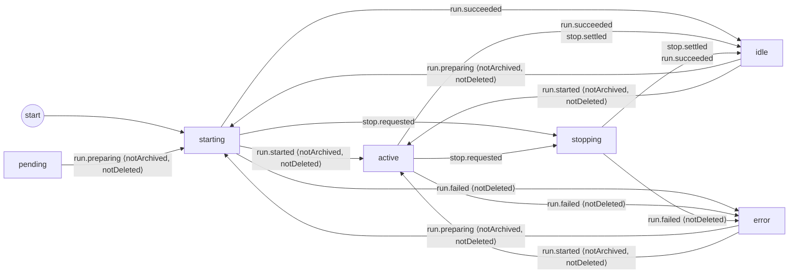
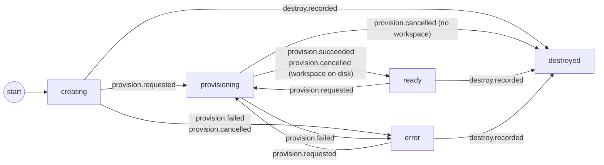

<!-- GENERATED FILE — do not edit by hand.
     Source: packages/domain/src/thread-lifecycle.ts and
     packages/domain/src/environment-lifecycle.ts.
     Regenerate: pnpm --filter @bb/domain exec vitest run test/lifecycle-diagram.test.ts -u -->

# Lifecycle state machines

Rendered from `THREAD_LIFECYCLE` and `ENVIRONMENT_LIFECYCLE`.

The thread table is the status projection of the persisted thread run
machine in `apps/server/src/services/threads/lifecycle/machine.ts`. That
machine also owns the turn requests awaiting a daemon answer, a turn
completion held for them, and an owed or acknowledged stop, and it is the
only writer of thread status. User requests, daemon command answers,
daemon events and reports, the turn-start deadline and server restart are
its inputs; each one picks the status moves below. The environment table
is consumed by `applyEnvironmentLifecycleEvent` in `@bb/db`.

How to read these: each edge groups all moves that transition between
the same two statuses. A label is `move ⟨supersession predicates⟩`; the
predicates are checked against the loaded row, and a failing predicate
leaves the status where it is. An **absent** edge means the move is not
available from that status.

## Thread

## Environment

